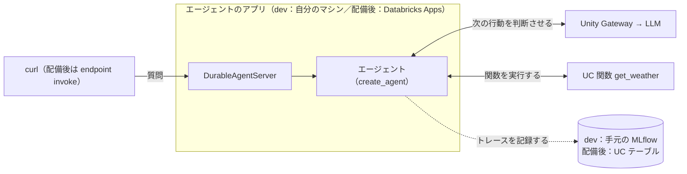

# Agent Bricks 入門メモ：最小のエージェントを段階的に作る

Databricks の Agent Bricks で、LLM とチャットし、Unity Catalog（UC）関数をツールとして呼ばせるまでを、最小構成から1つずつ足して整理したメモ。

- **扱う範囲**：コードでカスタムエージェントを作る Agent Bricks。ローカル実行（`dev`）、トレースの記録、Databricks Apps への配備まで。
- **想定する環境**：有料版の Databricks ワークスペース。
- **検証した環境**：2026年11月8日、有料版の Databricks ワークスペース、Agent Bricks CLI 0.9.0、Python 3.12。段階 1〜6 を確認した。
- **状態**：CLI の `--help` は「experimental（コマンドが後方互換なく変わりうる）」、クイックスタートは「ベータ」と書いている。
- **未検証**：ストリーミング・セッション・メモリ。第6章に整理した。
- **公式の入口**：[エージェント開発の概要](https://docs.databricks.com/aws/ja/agents/)／[クイックスタート](https://docs.databricks.com/aws/ja/agents/quickstart)／[FAQ](https://docs.databricks.com/aws/ja/agents/concepts/faq)

## 1. Agent Bricks とは

**Databricks のエージェント開発プラットフォーム。** 開発者がコードで書いたエージェントを、モデルやツールにつなぎ、ローカルで試し、Databricks 上に配備して運用するための土台を提供する。公式は機能を4つに整理している。

| 機能 | 内容 |
| --- | --- |
| エージェントのデプロイ | Agent ランタイムがエージェントをホストする |
| コードの安全な実行 | 分離環境（Databricks Sandbox）でエージェントが書いたコードを動かす |
| コンテキストの強化 | メモリとセッションで過去の会話を保持する |
| デバッグとテスト | MLflow Tracing が各ステップを記録する |

実行基盤は3層で説明されている。

```text
┌ フレームワーク／ハーネス … エージェントの振る舞いを書く層。LangGraph、OpenAI Agents SDK など。自分で書く。
├ エージェントサーバー ……… 上を HTTP サーバーで包み、API を公開する層（DurableAgentServer）。
└ エージェントランタイム … サーバーを動かす Databricks Apps 上のマネージド環境。配備すると使われる。
```

| 用語 | 意味 |
| --- | --- |
| エージェント | 依頼に対し、LLM が「答える」か「ツールを使う」かを判断し、結果を受けて処理を進めるプログラム |
| ツール | エージェントが呼べる関数。Python の関数、UC 関数、MCP サーバー、API など |
| UC 関数 | Unity Catalog に登録した関数。権限管理つきで、サーバーレス計算環境で実行される |
| MCP | ツールをつなぐための共通プロトコル。Databricks は UC 関数を MCP のエンドポイントとして公開している |
| Unity Gateway | モデルへの接続口。1つの API で複数のモデルを呼び、コードを変えずに切り替えられる |
| `agent.toml` | 使う UC 関数など、Databricks 側のリソースの宣言ファイル。CLI が読み書きする |

出典：[基本概念](https://docs.databricks.com/aws/ja/agents/concepts/)。

## 2. 他の Databricks 製品との違い

FAQ の整理。Agent Bricks はコードでカスタムエージェントを作る開発者向け。

- **Genie Agents**：ローコードで、テーブルや文書への質問に答える。Agent Bricks のエージェントからツールとして呼べる。
- **Genie One**：業務ユーザーがコードなしでデータと AI を使う画面。こちらもツールとして呼べる。
- **Omnigent**：コーディングエージェントなどの複数のエージェントを構成・調整するメタハーネス。Omnigent を使って、Agent Bricks 上で動くカスタムエージェントを開発できる。

## 3. このメモの進め方

公式の流れは `agentbricks init`（ひな形を作る）→ `dev`（手元で試す）→ `deploy`（配備する）。このメモは `init` を使わず、最小構成から1つずつ足す。

| 段階 | 足すもの | 学べること | ツールを実行する場所 |
| --- | --- | --- | --- |
| 1 | `create_agent` と `DurableAgentServer` | サーバーとエージェントの関係、API の呼び方 | （ツールなし） |
| 2 | 手元の Python 関数をツールにする | ツールとは何か | 自分のマシン |
| 3 | UC に登録した関数を読み込む | UC 関数の登録と呼び出し | Databricks のサーバーレス |
| 4 | `agent.toml` と `tools add` で宣言する | 宣言だけでツールを足す方法 | Databricks のサーバーレス（MCP 経由） |
| 5 | `configure_tracing()` | トレースの記録 | （変わらない） |
| 6 | `agentbricks deploy` | Databricks Apps への配備と、トレースの UC への保存 | Databricks のサーバーレス（配備したアプリの権限） |

## 4. 作ってみる

### 前提

- Databricks のワークスペース（有料版を想定）と、OAuth でログイン済みの Databricks CLI のプロファイル（このメモでは `DEFAULT`）。
  ```bash
  databricks auth login --host https://<workspace-url> --profile DEFAULT
  ```
- [uv](https://docs.astral.sh/uv/)
- Agent Bricks CLI
  ```bash
  uv tool install databricks-agentbricks
  ```

完成版（段階 6 まで）はこのリポジトリのルートにある。

### プロジェクトの初期化

```bash
mkdir hello-agentbricks && cd hello-agentbricks
uv init --lib --python 3.12
uv add "databricks-agentbricks[langgraph]" databricks-langchain fastapi-cli
uv add --dev ipykernel
```

`uv init --lib` が、`pyproject.toml`（ビルドバックエンドは uv 既定の `uv_build`）と、パッケージ `src/hello_agentbricks/` を作る。`ipykernel` は、段階 3 のスクリプトを `# %%` のセルで実行するための開発用。

Python は 3.12 を指定する。執筆時点で、公式は 3.11 以降を必須、3.12 を推奨としている。これより新しい Python では、依存パッケージのビルド済みパッケージ（wheel）が無く、ソースからのビルドで失敗してインストールや `agentbricks dev` がエラーになることがある（[Agent Bricks CLI](https://docs.databricks.com/aws/ja/agents/custom-agents/agent-bricks-cli) のトラブルシューティング）。

バージョンは指定せず、最新を入れる。執筆時点（2026年11月8日）に動作を確認したバージョンは次のとおり。

| パッケージ | バージョン |
| --- | --- |
| `databricks-agentbricks` | 0.9.0 |
| `databricks-langchain` | 0.21.0 |
| `fastapi-cli` | 0.0.32 |
| `ipykernel` | 7.4.0 |
| `langchain`（依存として入る） | 1.4.9 |
| `langgraph`（同上） | 1.2.20 |
| `mlflow`（同上） | 3.18.0 |

Agent Bricks は experimental なため、新しいバージョンで手順どおりに動かない場合は、まず `databricks-agentbricks` を上の版に固定して切り分ける。

`src/hello_agentbricks/__init__.py` には、サンプルの `hello()` 関数が入っている。使わないので、空にする。

```bash
: > src/hello_agentbricks/__init__.py
```

`pyproject.toml` の末尾に、`fastapi run` が起動するアプリの場所を追記する。

```toml
[tool.fastapi]
entrypoint = "hello_agentbricks.main:app"
```

### 段階 1：LLM とチャットする

```text
.
├─ pyproject.toml
├─ app.yaml                          ← 追加
└─ src/hello_agentbricks/
   ├─ __init__.py
   ├─ agent.py                       ← 追加
   └─ main.py                        ← 追加
```

`app.yaml`（`dev` と、配備後の Databricks Apps が、このコマンドでサーバーを起動する）：

```yaml
command: ["uv", "run", "fastapi", "run"]
```

`src/hello_agentbricks/agent.py`（モデルは `system.ai.gpt-oss-20b`。Unity Gateway 経由で呼ぶ）：

```python
from databricks_langchain import ChatDatabricks
from langchain.agents import create_agent

model = ChatDatabricks(endpoint="system.ai.gpt-oss-20b", use_ai_gateway=True)

agent = create_agent(
    model=model,
    tools=[],
    system_prompt="あなたは親切なアシスタントです。短く答えてください。",
)
```

`src/hello_agentbricks/main.py`：

```python
from databricks_agentkit import DurableAgentServer, InvocationContext

from hello_agentbricks.agent import agent

app = DurableAgentServer()


@app.invoke
async def invoke(input, context: InvocationContext) -> dict:
    result = await agent.ainvoke({"messages": input["messages"]})
    return {"answer": result["messages"][-1].content}
```

`@app.invoke` の関数が `/api/invocations` への依頼を受ける。`input` と戻り値の形は自由に決めてよい。

#### 起動して質問する

```bash
agentbricks --profile DEFAULT dev
```

コードを直しながら試すなら、自動で再読み込みされる `fastapi dev` も使える。

```bash
DATABRICKS_CONFIG_PROFILE=DEFAULT uv run fastapi dev
```

どちらも `http://localhost:8000` で待ち受ける。以降の段階では、Python のファイルを変えたら、`agentbricks dev` は `Ctrl+C` で止めて起動し直す（`fastapi dev` は自動で再読み込みされる）。

質問は、別のターミナルから次の curl で送る（`id` は毎回新しい UUID）。

```bash
curl -sS http://localhost:8000/api/invocations \
  -H 'Content-Type: application/json' \
  -d '{"id":"'$(uuidgen)'","input":{"messages":[{"role":"user","content":"こんにちは！短く挨拶してください。"}]}}'
```

`agent.toml` がない段階 1〜3 では、`dev` が `/invocations` と表示するが、正しいパスは `/api/invocations`（段階 4 以降は正しく表示される）。

**期待する結果**：

```json
{"id":"…","status":"completed","output":{"answer":"こんにちは！"}}
```

### 段階 2：手元の Python 関数をツールにする

天気を返す関数を足す。固定の文字列を返すだけの関数で、docstring の `Args:` が、LLM が読む引数の説明になる。関数は `functions` パッケージに置く。

```bash
mkdir src/hello_agentbricks/functions
touch src/hello_agentbricks/functions/__init__.py
```

`src/hello_agentbricks/functions/weather.py`：

```python
"""Unity Catalog に登録して実行できる、固定の応答を返す天気取得関数。"""


def get_weather(city: str) -> str:
    """指定した都市の現在の天気を返す。

    Args:
        city: 天気を知りたい都市の名前。

    Returns:
        都市名を含む、天気の文字列。
    """
    return f"{city}の天気は晴れ、気温は20℃です。"
```

`src/hello_agentbricks/agent.py` を、次の内容に置き換える：

```python
from databricks_langchain import ChatDatabricks
from langchain.agents import create_agent
from langchain_core.tools import tool

from hello_agentbricks.functions.weather import get_weather

model = ChatDatabricks(endpoint="system.ai.gpt-oss-20b", use_ai_gateway=True)

agent = create_agent(
    model=model,
    tools=[tool(get_weather, parse_docstring=True)],
    system_prompt="あなたは親切なアシスタントです。短く答えてください。",
)
```

`src/hello_agentbricks/main.py` を、どのツールが呼ばれたかも返す内容に置き換える：

```python
from databricks_agentkit import DurableAgentServer, InvocationContext

from hello_agentbricks.agent import agent

app = DurableAgentServer()


@app.invoke
async def invoke(input, context: InvocationContext) -> dict:
    result = await agent.ainvoke({"messages": input["messages"]})
    messages = result["messages"]
    return {
        "answer": messages[-1].content,
        "tool_calls": [c["name"] for m in messages for c in getattr(m, "tool_calls", [])],
    }
```

サーバーを起動し直して、「東京の現在の天気を教えて」と質問する。

**期待する結果**：`tool_calls` が `["get_weather"]` になり、固定の天気（「晴れ、気温は20℃」）を踏まえた回答が返る。関数は**自分のマシンで**動く。

### 段階 3：UC に登録した関数を呼ぶ

登録先のスキーマを作る。

```bash
databricks experimental aitools tools query "CREATE SCHEMA IF NOT EXISTS workspace.hello_agent" --profile DEFAULT
```

同じ関数を UC に登録する。`DatabricksFunctionClient` で `get_weather` を登録し（`replace=True` で上書き）、サーバーレスで試しに実行する。`# %%` でセルを分けてあり、関数を増やすときはセルを足す。

`scripts/register_functions.py`：

```python
"""Unity Catalog の Python 関数を登録し、動作を確認する。

登録する関数は src/hello_agentbricks/functions/ に置き、関数ごとにセル（# %%）を足す。
事前に、スキーマ workspace.hello_agent を作成しておく。
アプリのコードは、パッケージ hello_agentbricks として import できる（uv sync でインストールされる）。
実行はプロジェクトのルートで `uv run python scripts/register_functions.py`。
"""

# %% 準備
from unitycatalog.ai.core.databricks import DatabricksFunctionClient

from hello_agentbricks.functions.weather import get_weather

PROFILE = "DEFAULT"
CATALOG = "workspace"
SCHEMA = "hello_agent"

client = DatabricksFunctionClient(profile=PROFILE)

# %% get_weather：登録して（同名の関数があれば上書きする）、サーバーレスで動作を確認する
info = client.create_python_function(
    func=get_weather, catalog=CATALOG, schema=SCHEMA, replace=True
)
print(f"登録・更新した関数: {info.full_name}")

result = client.execute_function(
    function_name=f"{CATALOG}.{SCHEMA}.get_weather",
    parameters={"city": "東京"},
)
if result.error:
    raise RuntimeError(result.error)
print(f"実行結果: {result.value}")
```

```bash
uv run python scripts/register_functions.py
```

`src/hello_agentbricks/agent.py` を、UC 関数を読み込む内容に置き換える（公式の[UC 関数をツールにする手順](https://docs.databricks.com/aws/ja/agents/custom-agents/create-custom-tool)と同じ経路）：

```python
from databricks_langchain import ChatDatabricks, UCFunctionToolkit
from langchain.agents import create_agent
from unitycatalog.ai.core.databricks import DatabricksFunctionClient

model = ChatDatabricks(endpoint="system.ai.gpt-oss-20b", use_ai_gateway=True)

# UC に登録済みの関数を、ツールとして読み込む。実行はサーバーレス側で行われる。
client = DatabricksFunctionClient()
toolkit = UCFunctionToolkit(function_names=["workspace.hello_agent.get_weather"], client=client)

agent = create_agent(
    model=model,
    tools=toolkit.tools,
    system_prompt="あなたは親切なアシスタントです。短く答えてください。",
)
```

`main.py` は段階 2 のまま。サーバーを起動し直して、同じ質問を送る。

**期待する結果**：`tool_calls` が `["workspace__hello_agent__get_weather"]` に変わる。関数は Databricks のサーバーレスで動く。

### 段階 4：宣言だけでツールを足す

プロジェクトのルートに、最小の `agent.toml` を作る。

`agent.toml`：

```toml
schema_version = 1

[agent]
framework = "langgraph"
server = "agentbricks"
```

UC 関数をツールとして宣言する。`agent.toml` に `[[tools]]` が追記される。

```bash
agentbricks --profile DEFAULT tools add uc-function workspace.hello_agent.get_weather --auth app
```

```toml
[[tools]]
id = "get_weather"
auth = "app"
source = {kind = "uc_function", function = "workspace.hello_agent.get_weather"}
```

`src/hello_agentbricks/agent.py` を、`mcp_tools()` で `agent.toml` からツールを取得する内容に置き換える。リクエストごとに呼ぶので、エージェントを作る関数にする：

```python
from databricks_agentkit.langgraph import mcp_tools
from databricks_langchain import ChatDatabricks
from langchain.agents import create_agent

model = ChatDatabricks(endpoint="system.ai.gpt-oss-20b", use_ai_gateway=True)


async def build_agent():
    # agent.toml の [[tools]] を読み、MCP 経由でツールを取得する。
    tools = await mcp_tools()
    return create_agent(
        model=model,
        tools=tools,
        system_prompt="あなたは親切なアシスタントです。短く答えてください。",
    )
```

`src/hello_agentbricks/main.py` を、`agent` の代わりに `build_agent` を呼ぶ内容に置き換える：

```python
from databricks_agentkit import DurableAgentServer, InvocationContext

from hello_agentbricks.agent import build_agent

app = DurableAgentServer()


@app.invoke
async def invoke(input, context: InvocationContext) -> dict:
    agent = await build_agent()
    result = await agent.ainvoke({"messages": input["messages"]})
    messages = result["messages"]
    return {
        "answer": messages[-1].content,
        "tool_calls": [c["name"] for m in messages for c in getattr(m, "tool_calls", [])],
    }
```

サーバーを起動し直して、同じ質問を送る。

**期待する結果**：段階 3 と同じ `workspace__hello_agent__get_weather` が呼ばれる。

#### UC 関数がツールになる仕組み

質問のたびに `mcp_tools()` が `agent.toml` を読み直し、宣言された UC 関数を Databricks の MCP エンドポイント（`{ワークスペース}/api/2.0/mcp/functions/{catalog}/{schema}/{関数名}`）に問い合わせて、関数名・引数・説明をツール定義として受け取る。実行も同じエンドポイントで行う。

そのため、`agent.toml` の変更は再起動せずに反映される。`[[tools]]` を消して同じ質問を送ると `tool_calls` が空になり、戻すと再び呼ばれた。

#### `--auth`

ツールを誰の権限で実行するか。`user` は質問したユーザー、`app` はエージェントを動かすアプリのサービスプリンシパル。公式は、UC 関数で使えるのは `app` だけとしている。CLI の既定は `user` なので、`--auth app` を付ける。

### 段階 5：トレースを記録する

`main.py` に `configure_tracing()` を足す。`dev` が MLflow の接続先と実験名を環境変数で渡すので、設定はこれだけ（環境変数がなければ何もしない）。`dev` のトレースは手元のローカルの MLflow に記録される。配備先のトレースの保存先は、段階 6 で Unity Catalog にする。

`src/hello_agentbricks/main.py` を、次の内容に置き換える：

```python
from databricks_agentkit import DurableAgentServer, InvocationContext
from databricks_agentkit.langgraph import configure_tracing

from hello_agentbricks.agent import build_agent

configure_tracing()

app = DurableAgentServer()


@app.invoke
async def invoke(input, context: InvocationContext) -> dict:
    agent = await build_agent()
    result = await agent.ainvoke({"messages": input["messages"]})
    messages = result["messages"]
    return {
        "answer": messages[-1].content,
        "tool_calls": [c["name"] for m in messages for c in getattr(m, "tool_calls", [])],
    }
```

サーバーを起動し直して、同じ質問を送る。

**期待する結果**：`dev` の起動時に表示される `Traces http://127.0.0.1:<ポート>` を開くと、質問ごとに1件のトレースがある。処理の順に、`LangGraph` → `model`（`ChatDatabricks`）→ `tools`（`workspace__hello_agent__get_weather`）→ `model`（`ChatDatabricks`）が記録されている。

### 段階 6：Databricks Apps に配備する

配備したアプリのトレースは、Unity Catalog のテーブルに保存する（公式の推奨：[OpenTelemetryトレースをUnity Catalogに保存する](https://docs.databricks.com/aws/ja/mlflow3/genai/tracing/trace-unity-catalog)）。スパンはアプリからワークスペースの API 経由で、テーブルに書かれる。流れは、保存先の用意 → `agent.toml` への結び付け・配備 → 確認。

前提：

- トレースを置くカタログが、[デフォルトのストレージ](https://docs.databricks.com/aws/ja/storage/default-storage)上にないこと。ここでは、自分の S3 バケットを保存先にしたカタログ `workspace` を使う。
- SQL ウェアハウス。トレースの確認（`tracing list`）に使う。ID を控える：`databricks warehouses list --profile DEFAULT`。

#### 1. トレースの保存先を用意する

トレース用のスキーマを作る。

```bash
databricks experimental aitools tools query "CREATE SCHEMA IF NOT EXISTS workspace.agentbricks_traces" --profile DEFAULT
```

次に、トレースを Unity Catalog に保存する実験を作る。実験の保存先は、作成時にしか決められない。実験は、自分のホームフォルダ `/Users/<自分のメールアドレス>/hello-agentbricks` に作る。画面で作る方法（人が実施する場合）と、コードで作る方法（AI エージェントに実施させる場合）がある。結果は同じ。

**画面で作る**

1. 左のメニューの「エクスペリメント」→「エクスペリメントを作成」→「エージェント」を選ぶ。
2. 「エージェントとLLMアプリのエクスペリメントを作成する」で、次のように入力する。
   - **エクスペリメント名**：`hello-agentbricks`
   - **トレースの保存場所**：「Unity Catalog」（推奨）を選ぶ。もう一方の「エクスペリメント内」は最大 100,000 トレースで、UC には保存されない。
   - **Unity Catalog のロケーション**：「スキーマを選択」で `workspace.agentbricks_traces` を選ぶ。
   - **テーブル名のプレフィックス**：`hello_agentbricks`。空にすると実験 ID になる。

   プレフィックスの下に、「テーブルが作成される場所：workspace.agentbricks_traces.hello_agentbricks_*」と表示される。
3. 「エクスペリメントを作成」を押す。

**コードで作る**

`scripts/create_trace_experiment.py`：

```python
"""トレースを Unity Catalog のテーブルに保存する MLflow 実験を作る（既にあれば再利用する）。

事前に、スキーマ workspace.agentbricks_traces を作成しておく。
実験は、自分のホームフォルダ /Users/<自分のメールアドレス>/hello-agentbricks に作る。
実行はプロジェクトのルートで
`DATABRICKS_CONFIG_PROFILE=DEFAULT uv run python scripts/create_trace_experiment.py <SQL ウェアハウスの ID>`。
"""

import os
import sys

import mlflow
from databricks.sdk import WorkspaceClient
from mlflow.entities.trace_location import UnityCatalog

user = WorkspaceClient().current_user.me().user_name
EXPERIMENT_NAME = f"/Users/{user}/hello-agentbricks"

os.environ["MLFLOW_TRACING_SQL_WAREHOUSE_ID"] = sys.argv[1]
mlflow.set_tracking_uri("databricks")

experiment = mlflow.set_experiment(
    experiment_name=EXPERIMENT_NAME,
    trace_location=UnityCatalog(
        catalog_name="workspace",
        schema_name="agentbricks_traces",
        table_prefix="hello_agentbricks",
    ),
)
print(f"実験: {EXPERIMENT_NAME}（ID {experiment.experiment_id}）")
print(f"保存先: {experiment.trace_location.full_otel_spans_table_name}")
```

```bash
DATABRICKS_CONFIG_PROFILE=DEFAULT uv run python scripts/create_trace_experiment.py <SQL ウェアハウスの ID>
```

**期待する結果**（どちらの方法でも）：スキーマに `hello_agentbricks_otel_spans` など4つのテーブル（`_otel_annotations`・`_otel_logs`・`_otel_metrics`・`_otel_spans`）ができ、実験が `/Users/<自分のメールアドレス>/hello-agentbricks` にできる。

#### 2. `agent.toml` に結び付けて配備する

実験は、配備の前に結び付ける。実験がなければ、`tracing bind` と `deploy` が既定の保存先で作ってしまい、あとから UC に変えられない。

```bash
agentbricks --profile DEFAULT tracing bind --experiment-name /Users/<自分のメールアドレス>/hello-agentbricks
agentbricks --profile DEFAULT deploy hello-agentbricks
```

配備には初回は数分かかる。アプリ名は `agent-bricks-hello-agentbricks` になる。

アプリの権限は、`deploy` が付ける。実験とトレースの4つのテーブルをアプリのリソースとして登録し、サービスプリンシパルに、実験の `CAN_EDIT`、テーブルの `MODIFY` と `SELECT`、親のカタログとスキーマの `USE CATALOG` と `USE SCHEMA` が付く（[テーブルリソース](https://docs.databricks.com/aws/en/dev-tools/databricks-apps/tables)、[トレースの保存](https://docs.databricks.com/aws/ja/dev-tools/databricks-apps/mlflow)）。自分で作ったスキーマなら、手で権限を付ける作業は要らない。

#### 3. 質問して、トレースを確認する

```bash
agentbricks --profile DEFAULT endpoint invoke agent-bricks-hello-agentbricks \
  --path /api/invocations \
  --json "{\"id\":\"$(uuidgen)\",\"input\":{\"messages\":[{\"role\":\"user\",\"content\":\"東京の現在の天気を教えて\"}]}}"
```

**期待する結果**：`dev` と同じ形式で、`tool_calls` が `["workspace__hello_agent__get_weather"]` の応答が返る。UC 関数は、配備したアプリのサービスプリンシパルの権限で呼ばれる。

トレースは、画面の実験の「Traces」タブか、CLI で見る。CLI の `tracing list` は、UC のテーブルを SQL ウェアハウス経由で読むので `--warehouse` が要る。`--profile` だけでは、ウェアハウスの検索が既定のプロファイルを見に行くので、環境変数でも指定する。

```bash
DATABRICKS_CONFIG_PROFILE=DEFAULT agentbricks --profile DEFAULT tracing list --warehouse <SQL ウェアハウスの ID>
```

**期待する結果**：配備先で処理したトレースが、`Ok` で一覧に出る。画面の Traces タブにも、質問の入力・応答・実行時間が並ぶ。スパン（`LangGraph` → `model` → `ChatDatabricks` → `tools` → `workspace__hello_agent__get_weather` → `model`）は、テーブルを SQL で読める。

```sql
SELECT trace_id, name FROM workspace.agentbricks_traces.hello_agentbricks_otel_spans ORDER BY start_time_unix_nano
```

#### 4. 後片付け

不要になったら、アプリを削除する（停止だけなら `deployments stop`）。アプリ専用のランタイムストアも消える。

```bash
agentbricks --profile DEFAULT deployments delete agent-bricks-hello-agentbricks --yes
```

トレースのテーブルと実験は消えないので、不要なら別に消す（`DROP SCHEMA workspace.agentbricks_traces CASCADE` と、実験の削除）。UC に保存したトレースは、個別には削除できず、テーブルの行を SQL で消す（公式の制限）。

#### `server = "custom"` との違い

Free Edition のワークスペースでは、`agent.toml` の `server = "agentbricks"` のままだと、配備が途中で失敗した。`DurableAgentServer` の実行状態を保存するランタイムストアの作成が、`Scale-to-zero must be enabled for this workspace tier.` で拒否される。再実行しても同じで、CLI から設定は変えられない。`server = "custom"` にすると、ランタイムストアを作らずに配備できた。

`server` による違い（CLI 0.8.0 と 0.9.0 のソースで確認）：

|     | `agentbricks` | `custom` |
| --- | ------------- | -------- |
| ランタイムストア（実行状態の保存先） | 配備時に CLI がアプリごとに作る | 作らない。実行状態はプロセス内にあり、`dev` と同じ |
| リクエストしたユーザー本人の権限で動かす認証（`auth = "user"`） | 使える | エラーになる |
| CORS の許可リスト（`--allowed-origin`） | 使える | エラーになる |
| 配備後の案内に出る呼び出し先 | `/api/invocations` | `/invocations`（実際には `/api/invocations` で呼べた） |

## 5. 質問が回答になるまで



`dev` と配備後で変わるのは、アプリが動く場所とトレースの保存先だけ。LLM と UC 関数は、どちらも Databricks 側にある。

1. curl が `/api/invocations` に質問を送る。
2. エージェントが、質問・指示・使えるツールの説明を LLM に渡す。
3. LLM が、回答の代わりに **`get_weather` を `city="東京"` のような引数付きで呼ぶ要求**を返す。
4. エージェントの実行処理が、その要求に従って関数を動かす。
5. 結果を LLM に渡し直し、LLM が回答を作る。
6. 2〜5 の処理の中身（スパン）が、トレースとして記録される。`dev` は手元の MLflow、配備後は UC のテーブル。

**LLM はどのツールをどの引数で使うかを決める。関数を実際に実行するのはエージェントの実行処理。** ツールが必要なら「判断 → 実行 → 結果を受ける」を繰り返す。`create_agent` がこの繰り返しを行う。

## 6. 未検証と次の一歩

1. **ストリーミング・セッション・メモリ**：このメモでは検証しない。配備先（`server = "agentbricks"`）で試す（[エージェントサーバー](https://docs.databricks.com/aws/ja/agents/deploy/agent-server)、[エージェントのメモリとセッション](https://docs.databricks.com/aws/ja/agents/custom-agents/stateful-agents)）。
2. **MCP ツール**：`agentbricks tools add mcp system.ai.web_search` など。[MCPサーバーとエージェントツール](https://docs.databricks.com/aws/ja/agents/mcp-tools/)。
3. **評価と改善**：[MLflow の評価](https://docs.databricks.com/aws/ja/mlflow3/genai/eval-monitor/)。

## 参考資料

- [クイックスタート](https://docs.databricks.com/aws/ja/agents/quickstart)／[CLI リファレンス](https://docs.databricks.com/aws/ja/agents/custom-agents/agent-bricks-cli)
- [エージェントサーバー](https://docs.databricks.com/aws/ja/agents/deploy/agent-server)／[Agent Runtime](https://docs.databricks.com/aws/ja/agents/deploy/agent-runtime)
